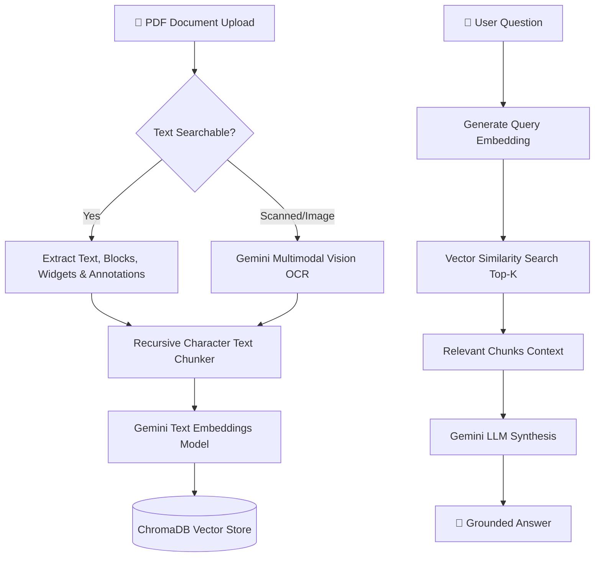

# 📄 PDF RAG Assistant — Document Intelligence Chatbot

A powerful **Retrieval-Augmented Generation (RAG)** chatbot application built with **Python**, **FastAPI**, **Google Gemini**, and **ChromaDB**. 

Upload any PDF document—including standard text PDFs, complex multi-column reports, interactive forms, and scanned image documents—and ask questions in natural language. Answers are strictly grounded in your document's contents.

---

## ✨ Features

- 🤖 **Google Gemini Powered**: Utilizes `gemini-3.6-flash` for intelligent context synthesis and `text-embedding-004` for 768-dimensional semantic embeddings.
- 👁️ **Multi-Layer Extraction & AI Vision OCR**:
  - **PyMuPDF & PyPDF**: Extracts text, structured blocks, interactive form fields, sticky notes, and rotated text.
  - **Gemini Multimodal Vision OCR**: Automatic fallback that renders scanned pages or photos into high-res images for vision transcription.
- 🗄️ **Persistent ChromaDB Vector Store**: Automatically chunks documents, computes embeddings, and performs top-k similarity retrieval.
- 🎨 **Neo-Brutalist Web UI**: Sleek, high-contrast, responsive web interface built with vanilla HTML5, CSS3, and JavaScript (FastAPI static server).
- 💻 **CLI Interface**: Includes standalone terminal scripts (`index.py` and `chat.py`) for quick command-line usage.
- 🔒 **Privacy-Focused Session Handling**: API keys are securely managed per session without permanent backend key storage.

---

## 🏗️ Architecture & RAG Pipeline



---

## 📁 Project Structure

```text
├── backend/
│   ├── main.py          # FastAPI application server & routing
│   ├── rag.py           # Vector retrieval & Gemini answer synthesis
│   └── upload.py        # PDF upload endpoint & vector database indexing
├── frontend/
│   ├── index.html       # Neo-Brutalist web UI structure
│   ├── script.js        # Dynamic frontend state & API integration
│   └── style.css        # Responsive styling system
├── chroma_db/           # Persistent ChromaDB vector database files
├── config.py            # Model configurations, chunk settings & paths
├── utils.py             # PDF text extraction, Vision OCR & Gemini embeddings
├── index.py             # CLI script to index sample PDF
├── chat.py              # CLI interactive chat loop
├── requirements.txt     # Python dependencies
├── .env.example         # Example environment variables file
└── README.md            # Project documentation
```

---

## 🚀 Quick Start

### 1. Prerequisites
- **Python 3.10+** installed on your system.
- A **Google Gemini API Key** (Get your free key from [Google AI Studio](https://aistudio.google.com/app/apikey)).

### 2. Installation
Clone the repository and install the dependencies:

```bash
# Clone the repository
git clone https://github.com/your-username/pdf-rag-chatbot.git
cd pdf-rag-chatbot

# Install Python requirements
pip install -r requirements.txt
```

### 3. Environment Configuration
Create a `.env` file in the root directory (optional if providing API key via web UI):

```env
GEMINI_API_KEY=your_gemini_api_key_here
```

---

## 🖥️ Running the Application

### Option A: Web Application (Recommended)
Start the FastAPI server:

```bash
python -m uvicorn backend.main:app --host 127.0.0.1 --port 8000
```

Open your browser and navigate to:
**`http://127.0.0.1:8000`**

1. Click **Select AI Model** in the topbar or sidebar to enter your Gemini API key.
2. Click **Upload Document** and pick any PDF file.
3. Start asking questions!

---

### Option B: Command Line Interface (CLI)
You can also index a PDF and query it directly from your terminal:

1. Place your PDF inside the project folder as `sample.pdf` (or edit `config.py`).
2. Run the indexer:
   ```bash
   python index.py
   ```
3. Launch the interactive chat loop:
   ```bash
   python chat.py
   ```

---

## 📡 API Reference

| Endpoint | Method | Description |
| :--- | :--- | :--- |
| `GET /api/status` | `GET` | Health check endpoint returning backend status |
| `POST /upload` | `POST` | Uploads PDF file, extracts text/OCR, chunks & indexes into ChromaDB |
| `POST /ask` | `POST` | Queries ChromaDB context and returns Gemini synthesized response |

### `POST /ask` Example Request Body
```json
{
  "question": "What are the key requirements mentioned in the document?",
  "api_key": "AIzaSy..."
}
```

---

## 🛠️ Tech Stack

- **Language**: Python 3.10+
- **LLM Engine**: Google Gemini API (`google-genai` SDK)
- **Vector Database**: ChromaDB
- **Backend Server**: FastAPI & Uvicorn
- **PDF Extraction**: PyMuPDF (`pymupdf`), PyPDF (`pypdf`), Gemini Multimodal Vision
- **Text Processing**: LangChain Text Splitters
- **Frontend**: Vanilla HTML5, CSS3, JavaScript
